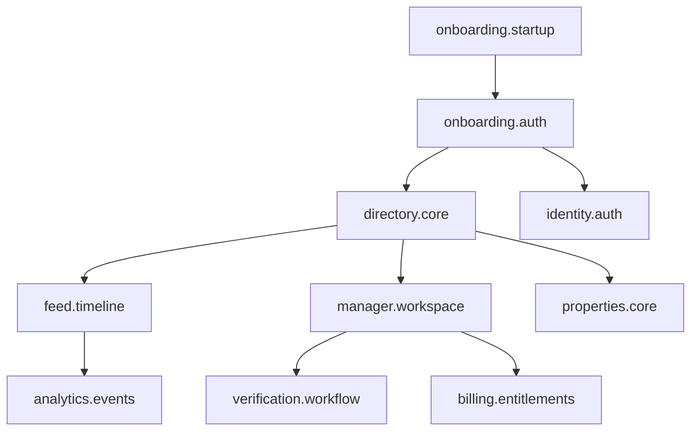
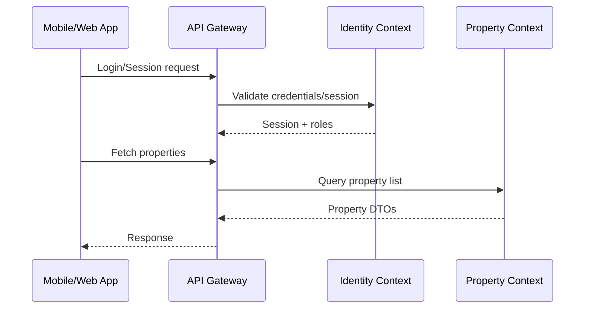

# YourHome Engineering Playbook v1

## 0) Purpose
Build YourHome as a production-intent system (iOS, Android, Web) with agent-safe execution.

Core rule: no feature work starts without a spec that answers **Where / What / How / Why**.

---

## 1) Delivery Rules (non-negotiable)

1. **Spec-first**
   - Required before implementation.
2. **PLAN vs SHIPPED discipline**
   - SHIPPED requires evidence block.
3. **Proof-before-post**
   - Commit + file scope + verify command + runtime proof.
4. **Production-intent defaults**
   - Security, observability, rollback, and parity are required thinking in every feature.

---

## 2) Module Map (Domain-first)

## Frontend Modules
- `onboarding.startup`
- `onboarding.auth`
- `directory.core`
- `feed.timeline`
- `manager.workspace`
- `shared.design-system`
- `shared.navigation`
- `shared.state`

## Backend Modules
- `identity.auth`
- `identity.profiles`
- `properties.core`
- `verification.workflow`
- `billing.entitlements`
- `notifications.dispatch`
- `analytics.events`
- `platform.integrations`

Rule: each module has clear ownership, API contract, and acceptance tests.

---

## 3) Bounded Contexts (DDD)

- **Identity Context**: users, sessions, roles
- **Property Context**: homes, ownership, listing state
- **Verification Context**: document/capture review lifecycle
- **Entitlement Context**: plans, access, billing status
- **Engagement Context**: feed, activity, notifications

No cross-context write coupling without explicit contract.

---

## 4) Mandatory Spec Template (Where/What/How/Why)

Copy this for every feature:

### Feature: <name>
- **Where**: module(s), route(s), API endpoints, DB tables
- **What**: behavior, UI states, inputs/outputs, edge cases
- **How**: architecture, data flow, contract changes, migration plan
- **Why**: product rationale + measurable outcome

### Acceptance
- UX acceptance checklist (screen/state by screen/state)
- Technical acceptance (tests, latency/error budgets, security checks)
- Rollout plan (flagged? phased?)
- Rollback plan (exact commands/steps)

---

## 5) SHIPPED Evidence Block (required)

```text
[STATUS] SHIPPED
Claim:
Evidence:
- Commit:
- Scope: (git show --name-only -n 1)
- Verify: (exact run command + result)
- Runtime proof: (platform + screenshot or LIVE BUILD marker)
Risk/Notes:
```

---

## 6) Definition of Done (Production)

A feature is done only if all are true:
- Spec approved
- Tests pass
- Cross-platform parity checked (iOS/Android/Web)
- Observability added (events + error path visibility)
- Security review completed for changed surface
- Rollback documented
- SHIPPED evidence posted in correct lanes

---

## 7) Visuals (recommended)

Use Mermaid for quick visual maps in docs.

### Module Map Diagram


### Request Flow (example)


---

## 8) Next Implementation Order

1. Freeze startup + auth as `onboarding-v1`
2. Build `shared.design-system` tokens (color/spacing/type)
3. Implement `directory.core` with explicit contracts
4. Add observability + alert paths for onboarding and auth
5. Run parity review and publish SHIPPED evidence
